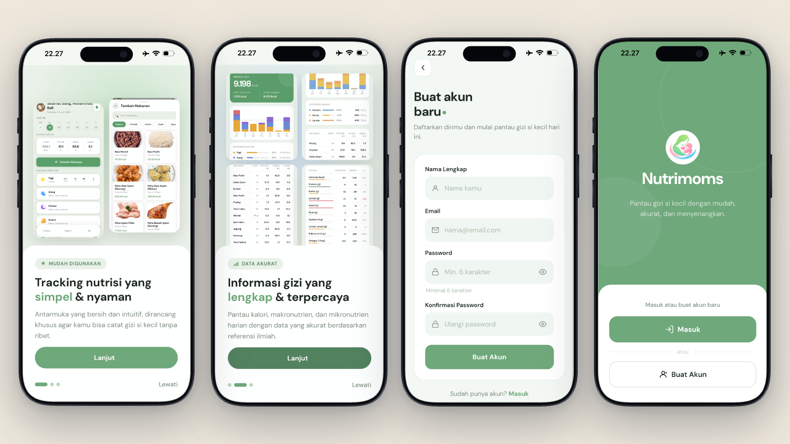
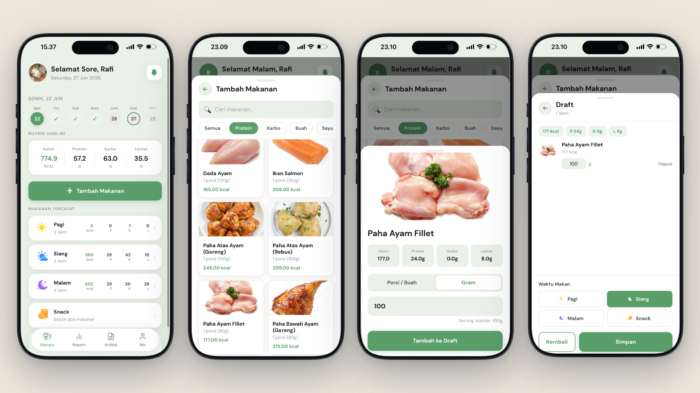
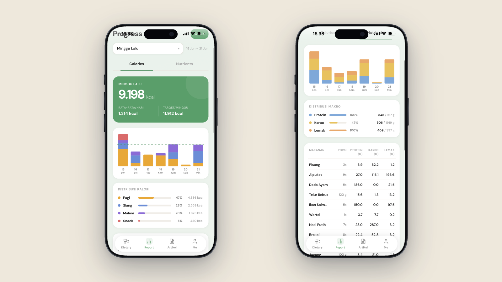
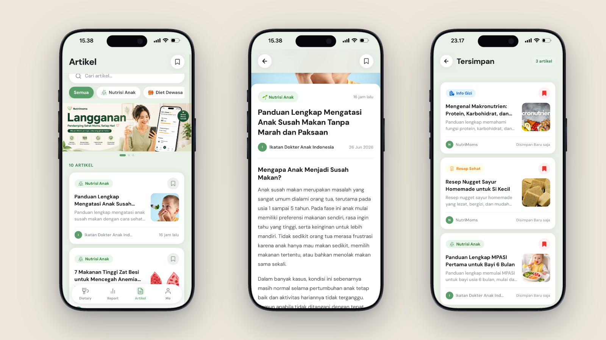
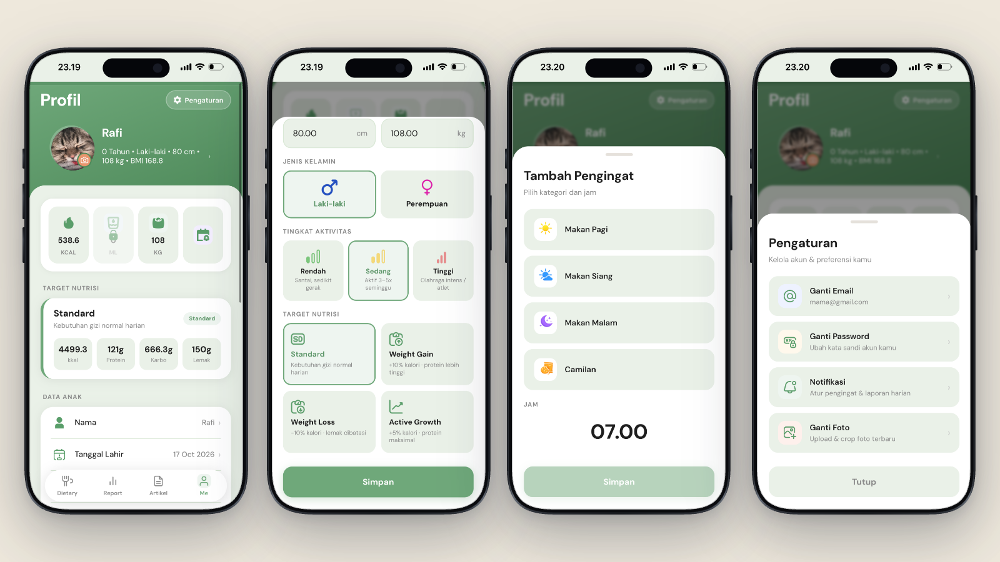
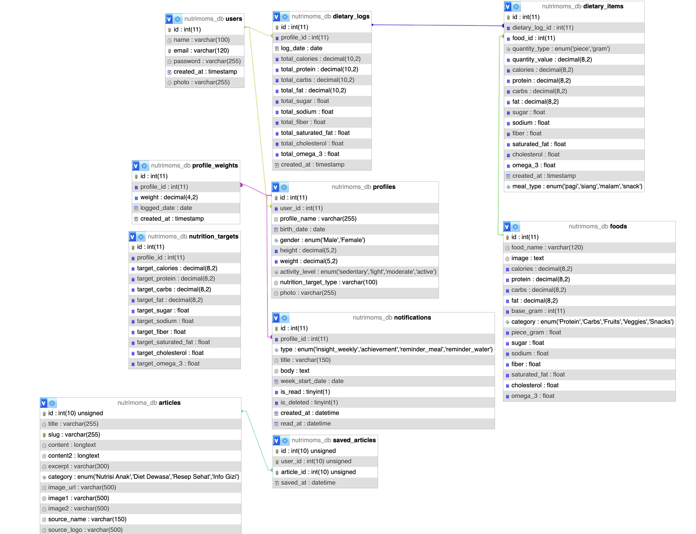

# nutrimoms-nutrition-tracker-fullstack
NutriMoms: mobile-first web app for tracking daily food intake and nutrition, built end-to-end as a solo university project (PHP, MySQL)

<p align="center">
  
</p>

<h1 align="center">NutriMoms</h1>

<p align="center">
  <b>Full Stack Developer Project</b><br>
  A mobile-first web app to track nutrition for the whole family, with a friendly UI and insightful analytics.
</p>

<p align="center">
  
  
  
  
  
  
</p>

> **Status:** Prototype. Development was stopped because the project period ended.

---

## About the Project

**NutriMoms** is a nutrition tracking application designed for mothers and families. Instead of tracking only one person, users can manage **multiple profiles** (for example mom, child, and other family members) and switch between them easily, so everyone's food intake and nutrition can be monitored in one place.

The app focuses on two things:

1. **A friendly, easy-to-use interface**, built mobile-first so logging a meal takes only a few taps.
2. **Useful analytics**, turning daily food records into clear charts and nutrient insights.

I designed and built this project end-to-end by myself: requirement analysis, database design, backend, frontend, and UI.

---

## Key Features

### 1. Onboarding, Login, and Create Account

<p align="center">
  
</p>

When the app is opened for the first time, users are guided through **onboarding screens** that introduce what the app can do: logging meals, reading nutrition insights, and tracking family health. After onboarding, users choose to **log in** or **create a new account**.

- Onboarding screens that explain the main insights and benefits of the app
- Login and registration with session-based authentication
- Clear flow from onboarding to the main app

### 2. Dietary Page (Food Log)

<p align="center">
  
</p>

The place where users manage everything they eat each day, with full **CRUD** (create, read, update, delete) on food entries.

- Foods are grouped into **4 meal times**: Breakfast, Lunch, Dinner, and Snack
- Choose the **number of portions** and the **amount in grams** for each food
- Entries are **easy to edit**, with no need to delete and re-add
- **Total calories update instantly** after every change
- Draft saving so an unfinished log is not lost

### 3. Insight Report

<p align="center">
  
</p>

The report page turns daily records into insights, divided into two tabs: **Calories** and **Nutrients**.

**Calories tab**
- Interactive bar chart using a **select state**: clicking a bar focuses all details on that day
- Calorie distribution across meal times
- List of the foods consumed on the selected day

**Nutrients tab**
- Same interactive bar chart, focused on the distribution of **protein, fat, and carbohydrates**
- Detailed **macro and micronutrient** information with actual values

### 4. Articles

<p align="center">
  
</p>

A reading section with general health and nutrition articles, organized **by category** (similar to a news app layout).

- Browse articles by category
- **Saved articles** feature, so users can bookmark and read them later

### 5. Settings

<p align="center">
  
</p>

- Edit profile name and photo
- Set **meal reminders**
- Change email and password
- Set the **daily calorie target**

### 6. Subscription (UI)

<!-- Uncomment after foto5.png is added to the images folder
<p align="center">
  
</p>
-->

A subscription plan page designed to explain the benefits of each plan clearly. This is a **UI design only**; no real payment is connected.

### Other Features

- Multi-profile switching (family members)
- Weight tracking with SVG charts
- Notification center

---

## Tech Stack

| Layer | Technology |
|---|---|
| Frontend | HTML5, CSS3, JavaScript (vanilla) |
| Data fetching | AJAX (asynchronous requests without page reload) |
| Backend | PHP (PDO, session-based authentication) |
| Database | MySQL |
| Charts | SVG-based charts |

---

## Database

The database uses a `profiles` table as an intermediary between a user account and the people being tracked, which makes the multi-profile feature possible.

The database structure is available in [`database/nutrimoms.sql`](database/nutrimoms.sql) (structure only, no personal data).

<!-- Optional: add an ERD image

-->

---

## Project Structure

```
nutrimoms-nutrition-tracker/
├── assets/          # CSS, icons, images
├── auth/            # login, register, logout
├── config/          # database configuration (see config.example.php)
├── database/        # SQL file (structure)
├── pages/           # main app pages
├── images/          # screenshots for this README
├── index.php
├── onboarding.php
└── README.md
```

---

## How to Run Locally

1. Install a local server such as **XAMPP** (Apache + MySQL).
2. Clone or download this repository into the `htdocs` folder.
3. Open **phpMyAdmin**, create a database named `nutrimoms`, then import `database/nutrimoms.sql`.
4. Copy `config/config.example.php` to `config/config.php` and fill in your database credentials.
5. Start Apache and MySQL, then open `http://localhost/nutrimoms-nutrition-tracker` in your browser.

---

## What I Learned

- Analyzing user needs and turning them into features
- Designing a relational database for multi-profile data
- Building interactive charts and dynamic pages with AJAX
- Designing a mobile-first, user-friendly interface

---

## Author

**Rafi**
Information Systems, Universitas Trisakti
